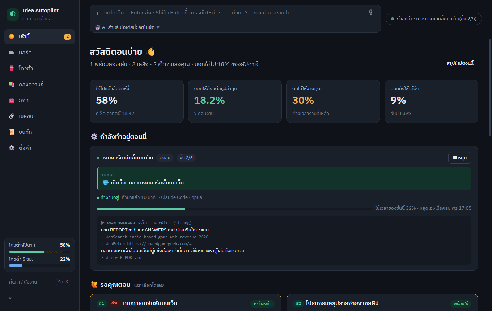
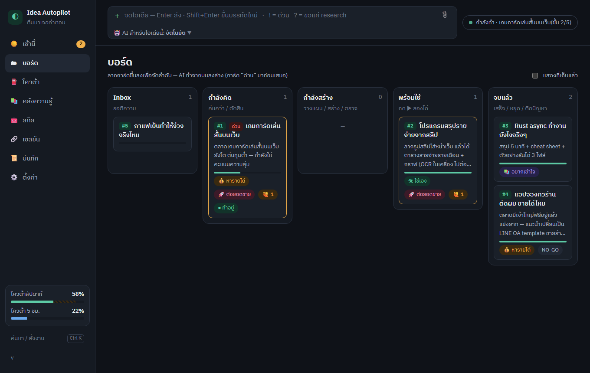
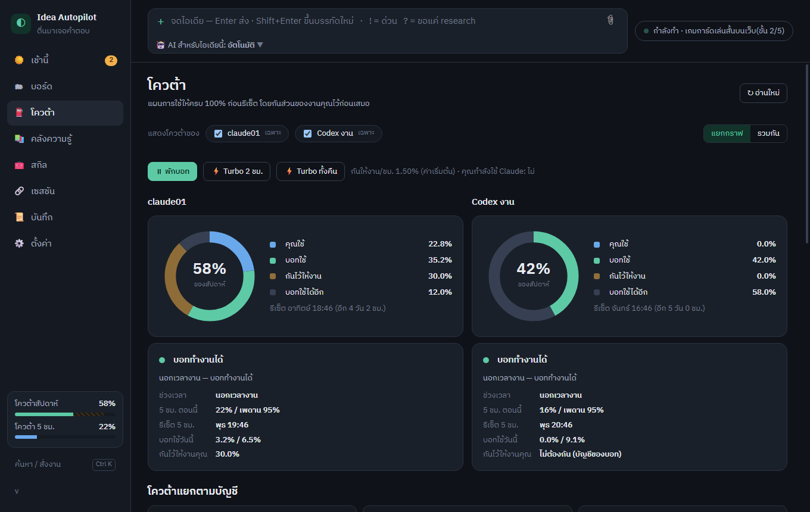
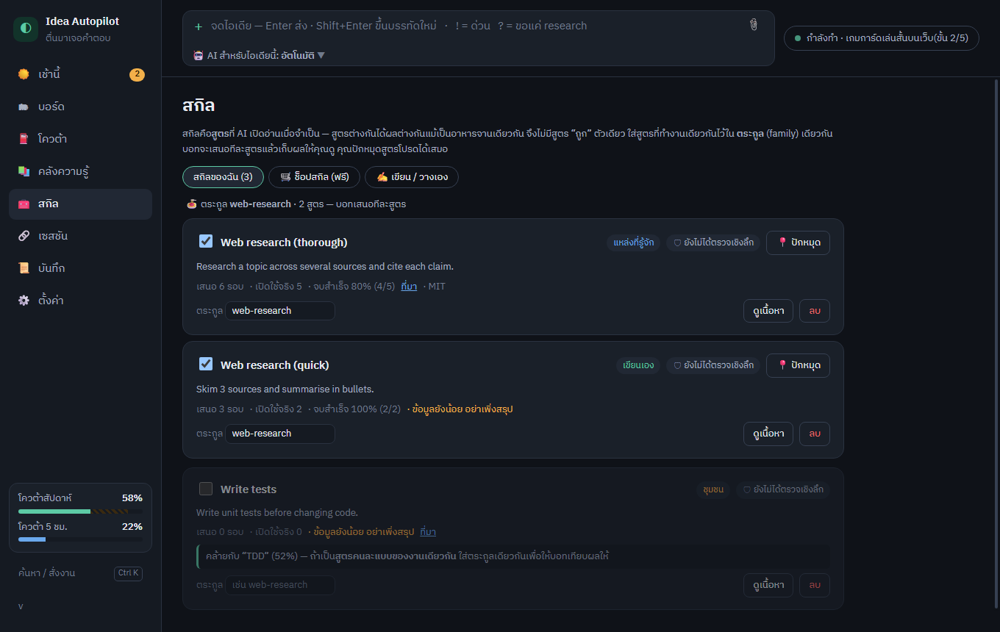
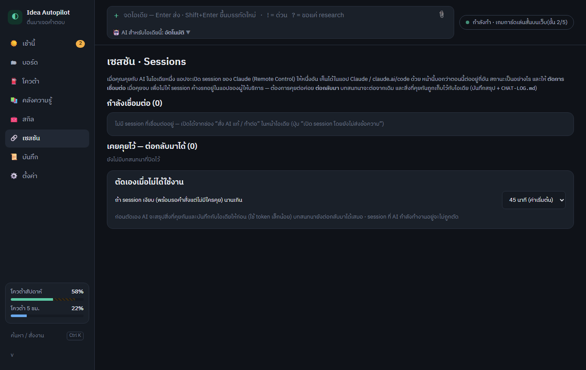

# Idea Autopilot

**Languages:** [ไทย](#ภาษาไทย) · English · [中文](docs/README.zh.md) · [日本語](docs/README.ja.md) · [한국어](docs/README.ko.md) · [Tiếng Việt](docs/README.vi.md) · [Bahasa Indonesia](docs/README.id.md) · [Español](docs/README.es.md) · [Français](docs/README.fr.md) · [Deutsch](docs/README.de.md) · [Português](docs/README.pt.md) · [Русский](docs/README.ru.md) · [العربية](docs/README.ar.md) · [हिन्दी](docs/README.hi.md) · [Italiano](docs/README.it.md) · [Türkçe](docs/README.tr.md)



> Jot an idea down in one line; an AI agent of your choice researches it, judges it, or builds a first version while you are away — using the quota you would otherwise waste, and never the part you need for your own work.

- **Any AI agent, not just one:** Claude Code, Codex CLI, Gemini CLI, OpenCode, or your own command. Model and effort are chosen per step by fixed rules (no tokens spent deciding), or pinned by you.
- **Respects your day:** a work calendar keeps the bot out of your way; Claude's real quota is read, other agents use an hour budget you set.
- **Your ideas stay yours:** everything lives in a local folder (one git repo per idea). A fresh install starts empty. No telemetry, no server.
- **Phone:** progress and "ready" notifications through your own Telegram bot; ideas can be typed in from there.
- **Windows 10/11**, built with Tauri 2 (Rust + Svelte). The interface and the AI's reports are in Thai by default (English reports can be chosen in Settings); the UI is not translated yet — contributions welcome.
- **License:** GPL-3.0-or-later, © 2026 bombxdev. See `LICENSE`, `CONTRIBUTING.md`, `CHANGELOG.md`, `docs/ISSUES.md`.

## Screenshots

(Demo data, not real ideas.)

| Board | Quota plan |
|---|---|
|  |  |
| **Skill library & safe free shop** | **Sessions** |
|  |  |

## Install (easiest first)

1. **Scoop** (one-time setup of [Scoop](https://scoop.sh), then two commands; no admin rights, updates keep your ideas):
   ```
   scoop bucket add bomb https://github.com/bombxdev/scoop-bucket
   scoop install idea-autopilot
   ```
   Update later with `scoop update idea-autopilot`.
2. **Installer:** download `IdeaAutopilot-<version>-Setup.exe` from [Releases](https://github.com/bombxdev/idea-autopilot/releases) and double-click.
3. **Portable:** download `IdeaAutopilot-<version>-portable.zip`, right-click it → Properties → tick **Unblock** → Extract, then run `bin\idea-autopilot.exe`.

4. **Android companion app:** download `IdeaAutopilot-mobile.apk` from Releases (allow installing unknown apps). It talks to your own private GitHub sync repo with a token you create; see the multi-device section.

Windows may show a SmartScreen warning for the installer (not signed yet): More info → Run anyway. You also need git and one logged-in AI agent (see the first-run steps below).

Build: `cd app && npm install && npm run build`, then `cd src-tauri && cargo build --release --features tauri/custom-protocol`. Installer + portable zip: `powershell -ExecutionPolicy Bypass -File scripts\package.ps1`. Not code-signed yet, so Windows SmartScreen may warn (More info → Run anyway) — see `docs/SIGNING.md`. Signing policy and privacy: `docs/CODE_SIGNING_POLICY.md`.

Code signing: free code signing is being requested from [SignPath Foundation](https://signpath.org) (SignPath.io); once approved, released installers will be signed with a certificate issued by SignPath Foundation. Policy: [docs/CODE_SIGNING_POLICY.md](docs/CODE_SIGNING_POLICY.md).

---

<a id="ภาษาไทย"></a>

(ภาษาไทย)

จดไอเดียทิ้งไว้ แล้วให้ AI (Claude Code, Codex CLI, Gemini CLI, OpenCode หรือคำสั่งของคุณเอง — ใช้ตัวที่คุณมี ไม่ต้องมีครบ) ไปค้นคว้า ตัดสิน หรือสร้างให้ตอนที่คุณไม่ได้ใช้ โดยหลบเวลางานของคุณ กันโควต้าไว้ให้งานหลักก่อน แล้วใช้ส่วนที่เหลือให้คุ้มก่อนโควต้ารายสัปดาห์รีเซ็ต

## ติดตั้งแบบง่าย (เรียงจากง่ายสุด)

1. **Scoop** (ติดตั้ง [Scoop](https://scoop.sh) ครั้งเดียว แล้วพิมพ์สองบรรทัดนี้ ไม่ต้องสิทธิ์แอดมิน อัปเดตแล้วไอเดียไม่หาย):
   ```
   scoop bucket add bomb https://github.com/bombxdev/scoop-bucket
   scoop install idea-autopilot
   ```
   อัปเดตทีหลังด้วย `scoop update idea-autopilot`
2. **ตัวติดตั้ง:** โหลด `IdeaAutopilot-<เวอร์ชัน>-Setup.exe` จากหน้า [Releases](https://github.com/bombxdev/idea-autopilot/releases) แล้วดับเบิลคลิก
3. **แบบพกพา:** โหลด `IdeaAutopilot-<เวอร์ชัน>-portable.zip` คลิกขวา → Properties → ติ๊ก **Unblock** → แตกไฟล์ แล้วเปิด `bin\idea-autopilot.exe`

ถ้า Windows ขึ้นหน้าเตือน SmartScreen (ยังไม่ได้เซ็นชื่อ) ให้กด More info → Run anyway ต้องมี git และ AI agent ที่ login แล้ว 1 ตัว (ดูขั้นตอนด้านล่าง)

## เริ่มใช้ครั้งแรก (สำหรับเพื่อนที่ได้ไฟล์ zip)

1. ต้องมี Windows 10/11, [git](https://git-scm.com) และ **AI agent อย่างน้อย 1 ตัวที่ login แล้ว** ตัวไหนก็ได้: [Claude Code](https://claude.com/claude-code), [Codex CLI](https://github.com/openai/codex), [Gemini CLI](https://github.com/google-gemini/gemini-cli), [OpenCode](https://opencode.ai) หรือโปรแกรมอื่นที่สั่งจาก command line ได้ (ใส่เป็น "คำสั่งของฉันเอง") บอทใช้โควต้าของ account คุณเอง
2. **แบบติดตั้ง (แนะนำ):** ดับเบิลคลิก `IdeaAutopilot-<เวอร์ชัน>-Setup.exe` (ไม่ต้องสิทธิ์ผู้ดูแล) ข้อมูลอยู่ที่ `%USERPROFILE%\IdeaAutopilot` แยกจากโปรแกรม อัปเดตครั้งต่อไปติดตั้งทับได้เลย ไอเดียไม่หาย ถ้า Windows ขึ้นหน้าเตือน SmartScreen ให้กด More info → Run anyway (ตอนนี้ยังไม่ได้เซ็นชื่อผู้เผยแพร่ ดู `docs/SIGNING.md`)
   **แบบพกพา:** แตกไฟล์ zip ไว้ที่ไหนก็ได้ เช่น `D:\IdeaAutopilot` แล้วเปิด `bin\idea-autopilot.exe` **เริ่มว่างเปล่าทั้งหมด** — ไม่มีไอเดียหรือข้อมูลของใครติดมา และข้อมูลทุกอย่างของคุณจะเก็บอยู่ในโฟลเดอร์นี้เท่านั้น
3. หน้า **ยินดีต้อนรับ** จะตรวจเครื่องให้ว่ามี AI ตัวไหน: เลือกตัวที่จะใช้ (หรือปล่อยให้เลือกอัตโนมัติ) กด **ทดสอบสั่งงานจริง** เพื่อเช็กว่า login แล้ว ตั้งเวลางาน (บอทจะหลบช่วงนี้) ตั้งงบ แล้วกด **เริ่มใช้งาน** ทุกช่องมีค่าเริ่มต้นที่ใช้ได้เลย ปรับทีหลังได้ที่หน้า **ตั้งค่า**
4. จดไอเดียแรกที่ช่องด้านบน หรือกด Ctrl+Shift+Space แล้วไปทำอย่างอื่นได้เลย

ความปลอดภัย: บอททำงานเฉพาะในโฟลเดอร์ `workspace\ideas\<ไอเดีย>` ห้าม push/publish/deploy ห้ามสมัครบัญชี และห้ามจ่ายเงิน (กฎอยู่ใน `AGENTS.md` ของทุกไอเดีย) ระดับการกันต่างกันตาม AI: Claude มีรายการคำสั่งต้องห้าม, Codex รันใน sandbox แบบเขียนได้เฉพาะโฟลเดอร์ไอเดีย, Gemini/OpenCode/คำสั่งของคุณเองอาศัยกฎในคำสั่งงานเป็นหลัก — บน Windows ยังไม่ใช่ sandbox แท้ ควรใช้กับเครื่องส่วนตัว

## ใช้งาน

| อยากทำ | วิธี |
|---|---|
| จดไอเดีย (กันกด Enter พลาด) | ช่องจดเป็นหลายบรรทัด Shift+Enter = ขึ้นบรรทัดใหม่ · ตั้งค่า → “ส่งไอเดียด้วยปุ่ม” เลือก Ctrl+Enter ส่งได้ · บอทรอ 90 วินาทีก่อนเริ่มไอเดียใหม่ · แก้ข้อความทีหลังได้ด้วยปุ่ม ✏️ ในหน้าไอเดีย (ชื่อโฟลเดอร์จะตามข้อความใหม่) |
| จดไอเดีย | กดปุ่มลัด **Ctrl+Shift+Space** จากที่ไหนก็ได้ พิมพ์ 1 บรรทัด แล้วกด Enter (ถ้าปุ่มนี้ไม่ว่าง ระบบจะเลือกปุ่มสำรอง ดูได้ที่หน้าตั้งค่า) |
| ไอเดียด่วน | ขึ้นต้นด้วย `!` เช่น `! เทียบราคา hosting ฟรี` |
| ขอแค่ research | ขึ้นต้นด้วย `?` เช่น `? กาแฟเย็นทำให้ง่วงจริงไหม` |
| จดเป็นไฟล์ | วาง `.md` / `.txt` ใน `workspace/inbox/` |
| ตอบคำถาม Claude | แตะตัวเลือกบนการ์ด (Claude เดาคำตอบไว้แล้ว งานจึงไม่หยุดรอ) |
| สั่งต่อ | ใช้ปุ่มใต้การ์ด: ไปต่อ / ขุดลึก / ลองอีกแนว / พอแค่นี้ / สั่งสั้นๆ |
| สั่ง AI แก้/ทำต่อทันที | เปิดไอเดีย → กล่อง **🛠 สั่ง AI แก้ / ทำต่อ** พิมพ์แล้วกด **ส่งให้ AI** (มือถือ, `ia ask <id> "…"`, Telegram `/ask <id> …` ก็ได้) — เปิด session `Idea#<id>` ให้ ถ้ามีอยู่แล้วส่งเข้าอันเดิม และโชว์ว่า AI กำลังทำอะไรเป็นภาษาคน |
| ลองของที่สร้างเสร็จ | กด **▶ ลองเล่น** |
| พักบอท / เร่ง | ใช้เมนู tray หรือหน้าโควต้า: Pause, Turbo 2 ชม., Turbo ทั้งคืน |
| ค้นหา / สั่งงาน | กด **Ctrl+K** |
| ดูย้อนหลังว่าบอททำอะไร กี่โมง ผลเป็นยังไง | หน้า **📜 บันทึก** หรือ `ia log 7` |

## สั่งงานจาก CLI / Claude Code (จากที่ไหนก็ได้)

แอปเปิด API ภายในเครื่องที่ `127.0.0.1:47821` ใช้ token จาก `data/api.json` และมีตัวสั่งงานคือ `bin/ia.exe`

```
bin\ia.exe status
bin\ia.exe add "? กาแฟเย็นทำให้ง่วงจริงไหม"
bin\ia.exe questions
bin\ia.exe answer 3 2
bin\ia.exe deeper 1 เน้นตลาดไทย
bin\ia.exe help
```

มี Claude Code skill `idea-autopilot` อยู่ที่ `~/.claude/skills/idea-autopilot/` ทำให้สั่งด้วยภาษาพูดได้ทุกช่องทางของ Claude Code บนเครื่องนี้ เช่น "จดไอเดียหน่อย…" หรือ "เมื่อคืนได้อะไรบ้าง"

## ไอเดียแต่ละอันเป็นโปรเจกต์ของตัวเอง + ใช้ AI หลายค่ายได้

- ทุกไอเดียมี **เลข** (เช่น **#14**) แปะอยู่บนการ์ดและหัวไอเดีย ใช้อ้างอิงเวลาสั่งงาน — ค้นด้วย `#14` ใน Ctrl+K ได้
- โฟลเดอร์ชื่อ `idea-<เลข>-<ชื่ออังกฤษ>` เช่น `idea-0001-phi-peaks-card-game` ดูชื่อก็รู้ว่าเรื่องอะไร (ไอเดียใหม่ Claude ตั้งชื่ออังกฤษให้ตอนตีความ)
- ทุกโฟลเดอร์ไอเดียเป็น **git repo ของตัวเอง** บอท commit ให้หลังทุกขั้น จึงเปิดเฉพาะไอเดียนั้นใน Orca / VS Code / เครื่องมือไหนก็ได้ และย้อนกลับได้
- `AGENTS.md` ในแต่ละไอเดียมีกฎและบริบทให้ AI ทุกค่าย (Codex, Gemini, OpenCode…) ทำงานแบบเดียวกับบอท
- กล่อง **🛠 สั่ง AI แก้ / ทำต่อ** เลือกได้ว่าจะส่งให้ใคร: **Claude** (ค่าเริ่มต้น เห็นความคืบหน้าในแอป) หรือ AI ค่ายอื่นที่ติดตั้งไว้ — แอปจะ commit เก็บไว้ก่อน แล้วเปิด agent นั้นใน [Orca](https://github.com/stablyai/orca) บน repo ของไอเดีย และพักบอทจากไอเดียนั้น 3 ชม.
- จาก CLI: `ia agents` ดูว่ามีตัวไหน · `ia handoff 1 codex "ทำหน้าตาให้สวยขึ้น"`

## ใช้ AI ตัวไหนก็ได้ (ไม่ต้องมีครบ)

แอปตรวจ PATH ของเครื่องเอง (เช็กใหม่ทุก 30 วินาที — ติดตั้งเพิ่มแล้วไม่ต้องเปิดแอปใหม่) และเลือกใช้ตัวแรกที่พบ หรือเลือกเองที่ **ตั้งค่า → AI ที่ใช้ทำงาน** ผลงานทั้งหมดเป็นไฟล์ในโฟลเดอร์ไอเดีย จึงเปลี่ยน AI กลางทางได้โดยงานเดิมไม่หาย

| AI | วัดโควต้า | หมายเหตุ |
|---|---|---|
| Claude Code | อ่านโควต้าจริง (5 ชม. + รายสัปดาห์) | เห็นความคืบหน้าละเอียด, Remote Control, skill, สมองพกพาจาก memory |
| Codex CLI | งบชั่วโมงของแอป | รันแบบ `codex exec` ใน sandbox เขียนได้เฉพาะโฟลเดอร์ไอเดีย |
| Gemini CLI | งบชั่วโมงของแอป | รันแบบ `gemini -p … --yolo` |
| OpenCode | งบชั่วโมงของแอป | รันแบบ `opencode run`, ชื่อโมเดลเป็น `provider/model` |
| คำสั่งของฉันเอง | งบชั่วโมงของแอป | ใส่คำสั่งเอง ใช้ `{prompt_file}` (ไฟล์คำสั่งงาน) และ `{model}` ได้ เช่น `aider --yes --message-file {prompt_file}` |

- **ระดับโมเดล (auto):** ถ้าไม่ระบุ บอทเลือกระดับ เร็ว / กลาง / แรง ตามกฎตายตัวของแต่ละขั้น (ตารางหัวข้อถัดไป) แล้วจับคู่กับโมเดลของ AI ที่ใช้ Claude = Haiku / Sonnet / Opus (ได้รุ่นล่าสุดเสมอ) ส่วน Codex และ OpenCode แอปอ่านรายชื่อโมเดลที่ AI นั้นมีอยู่ตอนนี้ (Codex: จากไฟล์ `models_cache.json` ของมัน, OpenCode: คำสั่ง `opencode models`) แล้วจัดระดับจากคำอธิบายของโมเดลเอง เช่น "fast and affordable", "frontier" รุ่นใหม่ออกมาก็ถูกหยิบไปใช้เองโดยไม่ต้องอัปเดตแอป Gemini CLI ไม่บอกรายชื่อ จึงใช้โมเดลเดียวกันทุกขั้นจนกว่าคุณจะกรอกชื่อเอง (ตั้งค่า → AI ที่ใช้ทำงาน)
- **effort:** Claude และ Codex ปรับได้ (งานเบาใช้ต่ำ งานตัดสินใจใช้สูง) ตัวอื่นข้ามค่านี้ไป
- **ระบุเองเมื่อต้องการ:** ตั้งค่า → โมเดลและ effort พิมพ์ระดับหรือชื่อโมเดลจริง และเลือก effort ต่อขั้นได้ ค่าที่ระบุจะชนะกฎอัตโนมัติทั้งหมด ถ้าเว้นหรือเลือก auto โปรแกรมเลือกให้
- **งบชั่วโมง:** AI ที่ไม่มีตัวอ่านโควต้า แอปจะนับเวลาที่บอทรันจริงเทียบกับงบต่อสัปดาห์ (ค่าเริ่มต้น 10 ชม. และไม่เกิน 3 ชม. ต่อ 5 ชม.) แล้วใช้กฎเวลางาน/เฉลี่ยรายวัน/โค้งสุดท้ายแบบเดียวกัน ถ้าใช้ Claude ด้วย API key (ไม่ใช่แพ็กเกจรายเดือน) ให้เลือกวัดแบบงบชั่วโมงได้
- **ไม่รู้ว่าคุณกำลังใช้ AI อยู่หรือเปล่า:** ตรวจได้เฉพาะ Claude (ใช้โควต้าร่วมกับบอท) ตัวอื่นพึ่งตารางเวลางานของคุณ
- **เปิดงานให้ AI อีกตัวทำต่อ** (กล่อง 🛠 ในแต่ละไอเดีย หรือ `ia handoff`): เปิดใน [Orca](https://github.com/stablyai/orca) ถ้ามี ไม่มีก็เปิดหน้าต่าง terminal ใหม่ในโฟลเดอร์ไอเดียให้ ด้วยคำสั่งงานใน `HANDOFF.md`
- **ทดสอบ:** ปุ่ม "ทดสอบสั่งงานจริง" (ตั้งค่า หรือหน้าต้อนรับ) ส่งคำสั่งสั้นๆ ให้ AI ตอบ OK เพื่อเช็ก login, ชื่อโมเดล และคำสั่งของคุณเอง ก่อนปล่อยให้ทำงานตอนกลางคืน

## สกิล: สูตรที่ให้ AI เลือกใช้ (หน้า 🧰 สกิล)

สกิลคือไฟล์ `SKILL.md` (มาตรฐานเปิด ใช้กับ AI ทุกค่าย) ที่บอกวิธีทำงานแบบหนึ่ง เหมือนสูตรอาหาร: พาสต้าทำได้หลายสูตร อร่อยคนละแบบ จึงไม่มีสูตร “ถูก” ตัวเดียว
- สูตรที่ทำงานเดียวกันใส่ใน **ตระกูล** เดียวกัน บอทเสนอทีละสูตร เก็บผลให้เทียบ คุณปักหมุดสูตรโปรดได้
- **ช็อปสกิลฟรี** ค้นจาก GitHub แสดงที่มา ไลเซนส์ ดาว ผ่านตัวสแกนความปลอดภัย ดึงเฉพาะข้อความ ผูก commit/hash กับที่คุณเปิดดู และ AI ติดตั้งเองไม่ได้
- **ตรวจลึกด้วย SkillSpector (NVIDIA, Apache-2.0):** โปรแกรมติดตั้งให้เองครั้งแรกเมื่อเครื่องมี [`uv`](https://docs.astral.sh/uv/) (ฟรี: `winget install --id astral-sh.uv`) ทำงานในเครื่อง ไม่รันสกิล ไม่ใช้ token ทุกสกิลถูกตรวจก่อนติดตั้งและหน้าสกิลมีป้าย 🛡 ผ่านการตรวจ / ควรระวัง / ไม่ผ่าน สกิลที่ไม่ผ่านจะไม่ถูกเสนอให้บอท โปรแกรมเช็กรุ่นใหม่จาก GitHub ให้ทุก 12 ชม. และกด “อัปเดต” ได้เอง ใช้คู่กับตัวสแกนในโปรแกรม (ตัวที่เข้มกว่าชนะ)
- แผนที่ตั้งใจทำต่อ (Role, Persona, แชร์พร้อมดาว): `docs/ROADMAP.md`

## สั่งงานผ่าน Telegram

1. ใน Telegram คุยกับ **@BotFather** → `/newbot` → ตั้งชื่อ → copy token
2. วาง token ในหน้า **ตั้งค่า → สั่งงานจากมือถือ (Telegram)**
3. ส่งข้อความอะไรก็ได้หาบอทของคุณ คนแรกที่ทักจะถูกผูกเป็นเจ้าของ (คนอื่นทักมา บอทจะไม่ตอบ)

พิมพ์ข้อความ = จดไอเดีย (`!` ด่วน, `?` research), คำถามของบอทจะส่งมาพร้อมปุ่มให้แตะตอบ, reply ข้อความของไอเดียเพื่อสั่งงานไอเดียนั้น, แจ้งเตือนงานเสร็จจะเด้งมาด้วย คำสั่งทั้งหมดดูได้จาก `/help` (`/status /list /q /show /report /go /deeper /alt /stop /now /say /pause /resume /turbo /digest /log`)

แอปดึงข้อความจาก Telegram เอง จึงไม่ต้องเปิดพอร์ตหรือมีเซิร์ฟเวอร์ ถ้าใช้หลายเครื่อง จะมีแค่เครื่องหลักที่ตอบบอท

ถ้าจะสั่งจากมือถือ ให้เปิด Remote Control ของ session บนเครื่องนี้ แล้วคุยต่อจาก claude.ai/code หรือแอป Claude บนมือถือ

## ประหยัด token: เลือกโมเดลและ effort อัตโนมัติ

(ตารางนี้เขียนด้วยชื่อโมเดลของ Claude: Haiku = ระดับเร็ว, Sonnet = กลาง, Opus = แรง — AI ตัวอื่นใช้ระดับเดียวกันและจับคู่กับโมเดลของตัวเอง ดูหัวข้อ "ใช้ AI ตัวไหนก็ได้")

ระบบเลือกโมเดลและ effort ด้วยกฎตายตัว จึงไม่เสีย token ในการตัดสินใจ ("ไม่จ้าง CEO มากวาดขยะ")

| ขั้น | โมเดล · effort | เหตุผล |
|---|---|---|
| ปรับแผน (replan) | Haiku · low | งานจัดคิวเล็กๆ |
| ตีความ, ค้นคว้า, เรียบเรียงความรู้, สร้าง, ตรวจ | Sonnet · medium | งานปริมาณมาก กิน token เยอะที่สุด |
| ทดลอง, เทียบแนวทาง | Sonnet · high | ต้องคิดละเอียด |
| ตัดสิน, วางแผน | Opus · medium | การตัดสินใจสำคัญ แต่ output สั้น |

กฎปรับเพิ่มเติม:

- **เคยติดขัด** (ล้มเหลว, หมดเวลา, หรือ build วนเกิน 3 รอบ): ขยับโมเดลขึ้น 1 ขั้นและเพิ่ม effort
- **โควต้าเหลือและกำลังจะหมดอายุ** (ช่วงโค้งสุดท้าย หรือเหลือมากกว่า 1%/ชม.): อัปเกรดงานค้นคว้า ตรวจ และทดลองเป็น Opus เพราะโควต้าที่ใช้ไม่หมดก็สูญเปล่าอยู่แล้ว
- **โควต้าใกล้หมด** (บอทใช้ได้อีกไม่ถึง 5%): ลด effort ลง 1 ขั้น
- **บังคับเอง**: เลือกโมเดลเองได้ในหน้าตั้งค่า

นอกจากนี้ บอททุกรอบปิด MCP server และเปิดเฉพาะเครื่องมือที่จำเป็น ทำให้ context ที่ต้องโหลดทุก turn ลดจาก ~35k เหลือ ~15k token (−58%)

**ทันสมัยเสมอเมื่อโมเดลเก่งขึ้น:**
- **เรียกรุ่นล่าสุดเสมอ:** เรียกโมเดลด้วยชื่อตระกูล (`haiku` / `sonnet` / `opus`) จึงได้รุ่นล่าสุดของแต่ละตระกูลอัตโนมัติ
- **บันทึกเวอร์ชันจริง:** ทุกรอบบันทึกเวอร์ชันจริงที่ใช้ เมื่อมีเวอร์ชันใหม่ สถิติของตระกูลนั้นจะเริ่มนับใหม่
- **ลองรุ่นถูกกว่าเป็นระยะ:** ทุก 5 รอบของขั้นเดียวกัน จะลองรุ่นที่ถูกกว่า 1 ขั้น ถ้าทำได้ดีพอๆ กัน (≥5 รอบ คุณภาพห่างกันไม่เกิน 5%) จะเปลี่ยนไปใช้ถาวร และถ้าผลแย่ลงภายหลังจะสลับกลับเอง
- **คุณภาพของรอบงาน:** นับว่าดีเมื่องานจบสำเร็จ เขียนสรุปผล และคุณไม่ได้กด "ขุดลึก", "ลองอีกแนว" หรือ "ลองใหม่" ภายใน 24 ชม.
- **ดูผลการเรียนรู้:** ดูได้ที่หน้าตั้งค่า หรือสั่ง `ia models`

ผลจริงของแต่ละโมเดลดูได้ที่หน้าโควต้า หัวข้อ "แยกตามโมเดล · effort" (จำนวนรอบ อัตราสำเร็จ และ % โควต้าที่ใช้)

## สมองพกพา (เอาสิ่งที่สอน Claude ไปใช้ที่อื่น)

ทุกวันระบบจะรวบรวมทุกอย่างที่คุณสอน Claude ไว้ในโฟลเดอร์ `brain/` หรือ `<sync>/brain/` ถ้าตั้งโฟลเดอร์ sync ไว้ ได้แก่ memory ของทุกโปรเจกต์, skill, คลังความรู้ และไอเดียทั้งหมด ไฟล์ทั้งหมดเป็น Markdown ธรรมดา

- `personal/`: เรื่องส่วนตัว (โปรไฟล์ หลักการทำงาน โปรเจกต์ส่วนตัว skill ส่วนตัว) เอาไปใช้ที่ไหนก็ได้
- `work/`: เรื่องงานบริษัท แยกไว้ให้คุณตัดสินใจเองว่าจะเอาไปด้วยหรือไม่
- `personal/BOOTSTRAP.md`: ไฟล์เดียวที่ copy ไปวางเป็น system prompt หรือ custom instructions ของโมเดลไหนก็ได้
- `personal/IMPORT.md`: วิธีกู้คืนเข้า Claude Code, claude.ai หรือโมเดลอื่น
- `classification.json`: ใช้แก้การแยกหมวดส่วนตัว/งาน (keyword หรือบังคับตามชื่อ)

สั่ง export ได้ทันทีด้วย `ia brain` หรือจากหน้าตั้งค่า

## ใช้หลายเครื่อง / ย้ายเครื่องหลัก

1. สร้างโฟลเดอร์ sync ได้ 2 แบบ (ใช้แบบใดแบบหนึ่ง หรือใช้ทั้งสองแบบเป็นแผนสำรองก็ได้)
   - **GitHub private repo:** สร้าง repo ว่างเอง แล้ว `git clone` ลงทุกเครื่อง ระบบจะ pull/push ให้ทุก 5 นาที
   - **Google Drive / OneDrive ส่วนตัว:** ใช้โฟลเดอร์ที่ sync ด้วยโปรแกรมของบริการนั้น
2. ใส่ path โฟลเดอร์นั้นในหน้าตั้งค่า หัวข้อ "หลายเครื่อง" ของทุกเครื่อง
3. เครื่องแรกที่ตั้งจะเป็น **เครื่องหลัก** (รันบอท) เครื่องอื่นเป็น **เครื่องรอง** ซึ่งจดไอเดีย ดูรายงาน และตอบคำถามได้ โดยคำสั่งจะถูกส่งไปให้เครื่องหลักทำ
4. วางไฟล์ `.md` ใน `<sync>/inbox/` จากอุปกรณ์ไหนก็ได้ (รวมถึงมือถือ) เพื่อจดไอเดีย
5. วันที่จะเลิกใช้เครื่องเดิม ให้กด **"ย้ายเครื่องหลักมาที่นี่"** บนเครื่องใหม่ (หรือสั่ง `ia takeover`) ระบบจะดึงข้อมูลล่าสุดมา แล้วเครื่องเดิมจะหยุดรันบอทเอง

ไฟล์ sync เป็น JSON/CSV ขนาดเล็ก (ไม่ใช่ไฟล์ฐานข้อมูล) ทำให้ git diff อ่านได้และไม่บวม ส่วนโฟลเดอร์ build ขนาดใหญ่ เช่น `node_modules` จะไม่ถูก sync

## แชร์ให้เพื่อน

- **เวอร์ชัน:** ดูเลขเวอร์ชันได้ที่มุมซ้ายล่างและ ตั้งค่า → เกี่ยวกับ ทุกครั้งที่ติดตั้ง/อัปเดตจะมีหน้า “มีอะไรใหม่” และดูประวัติทุกเวอร์ชันย้อนหลังได้ (`CHANGELOG.md`)
- **ส่งตัวติดตั้ง:** ส่ง `dist/IdeaAutopilot-<เวอร์ชัน>-Setup.exe` ให้เพื่อนเป็นหลัก (ติดตั้งทับเพื่ออัปเดต ข้อมูลไม่หาย) ส่วน zip ไว้ใช้แบบพกพา
- **ออกเวอร์ชันใหม่:** แก้เลข `version` ใน `app/src-tauri/tauri.conf.json`, `app/src-tauri/Cargo.toml`, `app/package.json` ให้ตรงกัน เพิ่มหัวข้อใน `CHANGELOG.md` และ `docs/ISSUES.md` แล้วรัน `scripts\package.ps1`

- สร้างไฟล์ด้วย `powershell -ExecutionPolicy Bypass -File scripts\package.ps1` ได้ตัวติดตั้งและ zip ใน `dist/` ส่งไฟล์นี้ให้เพื่อน (ไม่ต้องส่ง source หรือโฟลเดอร์ของคุณ) เพื่อนแตกไฟล์แล้วเปิด `bin/idea-autopilot.exe` ได้เลย
- **ไม่มีข้อมูลของคุณติดไป:** zip มีแค่โปรแกรม, `ia.exe`, README และโฟลเดอร์ `data` ว่าง ทุกอย่างอื่น (กฎของบอท ไฟล์ไอเดีย ตารางงาน) สร้างใหม่ตอนเพื่อนเปิดใช้ครั้งแรก สคริปต์แพ็กจะรัน `scripts\privacy-check.ps1` ตรวจก่อนทุกครั้งว่าไม่มีชื่อผู้ใช้ path ในเครื่อง ชื่อบริษัท หรือไอเดียของคุณหลุดเข้าไป ถ้าเจอจะไม่สร้าง zip (ใส่คำที่อยากให้ตรวจเพิ่มไว้ใน `scripts\privacy-words.txt` ซึ่งไม่ถูก commit)
- แอปมือถือ Android (`IdeaAutopilot-mobile.apk`) แยกไฟล์ต่างหาก ไม่อยู่ใน zip: โหลดจากหน้า Releases แล้วติดตั้ง (ต้องอนุญาต "ติดตั้งแอปที่ไม่รู้จัก") แอปไม่มีข้อมูลของใครติดมา ตอนเปิดครั้งแรกจะให้ใส่ GitHub private repo ที่ใช้เป็นโฟลเดอร์ sync ของคุณเอง และ fine-grained token (สิทธิ์ Contents: Read and write) token เก็บในมือถือและส่งไปที่ api.github.com เท่านั้น
- เพื่อนต้องมี Windows 10/11, git และ AI agent อย่างน้อย 1 ตัว (ดูหัวข้อ "เริ่มใช้ครั้งแรก") และตั้งเวลางานของตัวเองตอนเปิดครั้งแรก
- ถ้าจะแชร์ source ผ่าน git: `.gitignore` กันข้อมูลส่วนตัว (`data/`, `workspace/ideas/`, `brain/`) ไว้แล้ว แต่ประวัติ commit เก่าอาจมีไฟล์ที่เคยถูก commit ไว้ ให้ตรวจก่อน หรือแชร์เป็น zip แทน

## กฎการใช้โควต้า

ตัวเลขด้านล่างเป็นค่าเริ่มต้น "เวลางาน" คือตารางที่คุณตั้งในหน้าตั้งค่า (ค่าเริ่มต้น จ.–ศ. 09:00–18:00 พักเที่ยง 12–13 เสาร์–อาทิตย์หยุด รองรับเสาร์ตามสัปดาห์ของเดือนและครึ่งวัน) "โควต้า" คือโควต้าจริงของ Claude หรืองบชั่วโมงของแอปสำหรับ AI ตัวอื่น

- **เวลางาน:** บอทเริ่มงานได้เฉพาะเมื่อคุณไม่ได้ใช้ AI และโควต้า 5 ชม. ยังต่ำกว่า 40% ถ้าโควต้า 5 ชม. เกิน 60% บอทจะหยุดงานที่ทำอยู่
- **นอกเวลางานและวันหยุด:** บอทใช้โควต้า 5 ชม. ได้ถึง 95%
- **กันโควต้าให้งานคุณ (เฉพาะ Claude ที่อ่านโควต้าจริง):** กันไว้ตามจำนวนชั่วโมงทำงานที่เหลือก่อนรีเซ็ต ค่าเริ่มต้น 1.5% ต่อชั่วโมง เมื่อเก็บสถิติได้พอจะเปลี่ยนไปใช้ค่าที่วัดจากการใช้งานจริง (p80) ส่วนงบชั่วโมงนับเฉพาะเวลาของบอท จึงไม่ต้องกัน
- **โควต้ารายวันของบอท:** ส่วนที่บอทใช้ได้จะถูกเฉลี่ยตามวันที่เหลือ วันหยุดได้ส่วนแบ่งเป็น 2 เท่า
- **Window priming:** ถ้ารอบ 5 ชม. จะยังไม่หมดตอนเริ่มงาน บอทจะใช้ได้แค่ 30% เพื่อให้คุณมีโควต้าเหลือพอตอนเช้า
- **โค้งสุดท้าย:** 12 ชม. ก่อนรีเซ็ต ถ้าไม่ใช่เวลางาน ระบบจะยกเลิกเพดานรายวัน และให้บอทใช้ที่เหลือให้หมด
- **ถ้าอ่านโควต้าไม่ได้:** บอทจะหยุดเพื่อความปลอดภัย

## โฟลเดอร์

- `app/`: ตัวโปรแกรม (Tauri 2 + Rust + Svelte)
- `workspace/ideas/<idea>/`: งานของแต่ละไอเดีย เช่น `REPORT.md`, `KNOWLEDGE.md`, `PLAN.md`, `prototype/` และ log ของแต่ละรอบ
- `workspace/knowledge/`: คลังความรู้
- `data/quota.db`: สถิติโควต้า รอบงาน และไอเดีย (SQLite) ส่งออกเป็น CSV ได้จากหน้าโควต้า
- `docs/ISSUES.md`: รายการปัญหาที่เจอและวิธีแก้ของตัวแอป (ทุกครั้งที่แก้อะไรให้เพิ่มรายการ) ส่วนปัญหาของแต่ละไอเดียอยู่ใน `ISSUES.md` ในโฟลเดอร์ไอเดีย และดูได้ที่แท็บ “⚠ ปัญหา/วิธีแก้”
- `scripts/`: `package.ps1` (สร้าง zip ให้เพื่อน), `privacy-check.ps1` (ตรวจว่าไม่มีข้อมูลส่วนตัวหลุด), `deploy.ps1` (อัปเดตตัวที่ติดตั้ง)

## Build

```
cd app
set NODE_OPTIONS=--use-system-ca
npm install --registry=https://registry.npmmirror.com
npm run build
cd src-tauri
cargo build --release --features tauri/custom-protocol
```

อัปเดตตัวที่ติดตั้งไว้ในคำสั่งเดียว: `powershell -ExecutionPolicy Bypass -File scripts\deploy.ps1` (build → รอให้บอททำรอบปัจจุบันเสร็จ → ปิดโปรแกรม → แทนไฟล์ใน `bin\` → เปิดใหม่)

หรือทำเอง: เมื่อ build เสร็จ ให้ปิดโปรแกรมเดิมจากเมนู tray แล้ว copy `app/src-tauri/target/release/idea-autopilot.exe` ไปไว้ที่ `bin/` ตัวที่เปิดพร้อม Windows คือ `bin/idea-autopilot.exe`

ถ้าจะทดสอบ:

- `cargo test`: ทดสอบกฎปฏิทินและตัวคุมโควต้า
- `npm run dev`: เปิดดู UI ด้วยข้อมูลตัวอย่างใน browser
